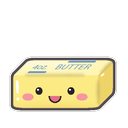
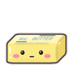
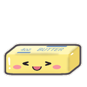
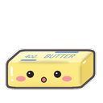
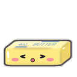
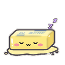

# Avatars

Every avatar Shepherd can wear is drawn in code by `tools/avatars/`: ink outlines with a slight hand wobble and pencil hatching, rendered at 4× and downsampled. No image generator is involved, and rebuilding unchanged code reproduces the committed PNGs exactly.

| Avatar | Look |
|---|---|
| `ram` (Ram, default) | Herdr's ram as an eSheep-style desktop sheep in Catppuccin Mocha colours: soft lavender wool, a dark face with a rosewater curled horn and a `>_` prompt for an eye. He faces right, trots while working, grazes when idle and naps lying down. |
| `block` (Block) | A hatched terracotta box with two tall eyes, stub arms and four thin legs. |
| `soft-spark` (Soft Spark) | A radial spark with a tall tuft, soft rounded rays, two padded feet and a small smile. |
| `catpuccino` (Catpuccino) | An anime caramel cat with big shiny eyes and round ears, sitting in a cappuccino cup on a saucer, wearing a foam cap with a latte-art heart; his tail is the cup's handle. He kneads the rim while working, pops out cheering when a response ends, waves a pink-beaned paw when an agent needs you and dozes low in the cup. |
| `unicorn` (Unicorn) | A chubby white unicorn sitting front-on, with a pastel rainbow mane and tail, a gold spiral horn, a pink muzzle and lilac hooves. His horn glows and sparkles rise while working, he hops when a response ends, raises a hoof and waves when an agent needs you, dozes with his head tilted and giggles under floating hearts when hovered. |
| `squishy` (Squishy) | A round, glossy bao squishy toy in pastel pink, lilac and sky blue with glitter, a pinched top of three soft tips, three long folds, big sparkly eyes and pink cheeks. Unlike the hatched avatars it is shaded smooth, like jelly foam. He squashes with a bulging belly and rises back slowly like slow-rise foam, his tips swinging a beat behind; he puffs steam while working, springs into the air and lands in a squash when a response ends, hops in alarm when an agent needs you, melts flat to doze and squeezes his eyes shut under floating hearts when hovered. |
| `butter-stick` (Butter Stick) | A squishy, long stick of butter in soft yellow with a grey outline and a blue 4oz. BUTTER wrapper print on top, a kawaii face on its long side with pink cheeks, and a glossy highlight. Like Squishy he is shaded smooth rather than hatched. He breathes and now and then squashes and rises back slowly while idle, melts down a little while working into a flowing, lobed puddle with loose droplets around his base, then firms back up, springs into the air and lands in a squash when a response ends, hops in alarm when an agent needs you, dozes shrunk into his puddle and floats hearts when hovered. |

## Reactions

Every avatar in every reaction, looping as Shepherd plays them.

| | Idle | Working | Finished | Needs you | Hover | Resting |
|---|:---:|:---:|:---:|:---:|:---:|:---:|
| **Ram** |  |  |  |  |  |  |
| **Block** |  |  |  |  |  |  |
| **Soft Spark** |  |  |  |  |  |  |
| **Catpuccino** |  |  |  |  |  |  |
| **Unicorn** |  |  |  |  |  |  |
| **Squishy** |  |  |  |  |  |  |
| **Butter Stick** |  |  |  |  |  |  |

## Layout

```
assets/avatars/<id>/
  avatar.json        frame map
  idle.png           one horizontal strip per reaction
  working.png
  finished.png
  needs-you.png
  resting.png
  hover.png
```

`avatar.json` (version 2) names the avatar and, for each of the six reactions, its strip, `frameCount`, `playback` and ordered `frames` of `{index, durationMs}` where `index` is a zero-based cell in that strip. A strip is `frameCount × 128` by 128 px RGBA. `loop` repeats, `hold` plays once and keeps its last frame, and `once` ends after its last frame and hands back to whatever Shepherd was showing.

Cells share the ground anchor `(64, 112)`. Every grounded pose's lowest pixel sits on it; hop frames lift off it. Cells display at native 128 px.

## Adding a reaction or an avatar

- A new avatar is a module in `tools/avatars/` exposing `ID`, `NAME`, `NEUTRAL`, `render(pose, seed)` and `ANIMATIONS`, registered in `build.py`, plus a case in the app's `Avatar` enum.
- A new reaction is a new `ANIMATIONS` entry in every avatar module, a new `CompanionAnimation` case, and the verifier's `REACTIONS` set.

## Rebuild and check

Requires Python 3 and Pillow 12.1 or newer.

```sh
python3 tools/avatars/build.py --contact-sheet /tmp/avatars.png
python3 tools/avatars/verify.py
python3 tools/avatars/showcase.py
```

The verifier checks each pack's frame map against its strips, antialiased edges, 4 px safe margins, that nothing sinks below the ground and every reaction starts on it, hover head clearance, and stray specks. The showcase script turns the packs into the looping animated PNGs under `docs/images/avatars/` that the main README shows; rerun it whenever a pack changes.

## Preview

From the repository root run `python3 -m http.server 8765 --bind 127.0.0.1` and open http://127.0.0.1:8765/tools/avatars/preview/. Pick an avatar and a reaction, pause or replay, and compare light and dark backgrounds at 64, 128 or 192 px.
